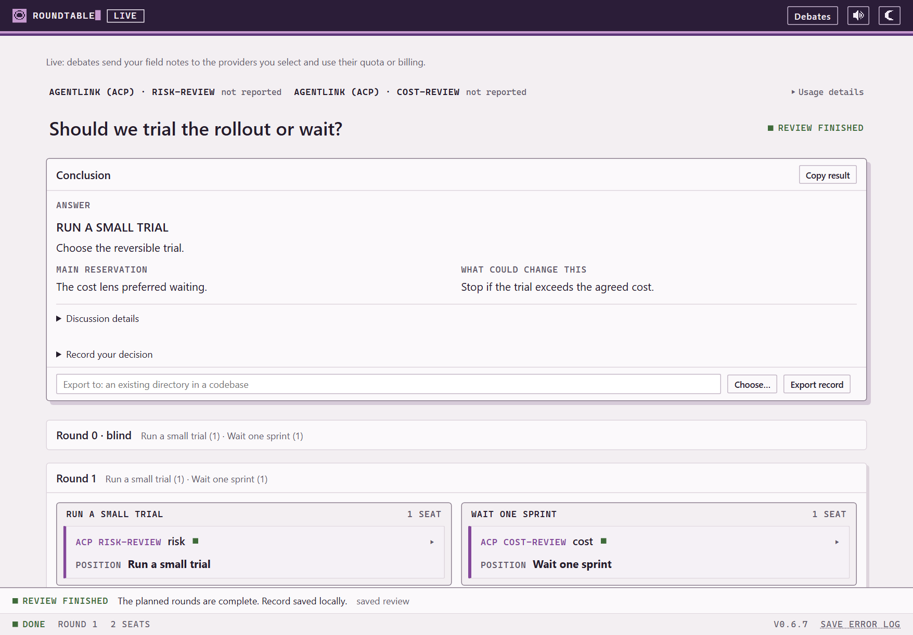

# Roundtable

[](https://www.npmjs.com/package/@prplkane/roundtable)
[](https://github.com/prplkane/roundtable/actions/workflows/test.yml)
[](package.json)
[](LICENSE)

Run decision reviews with multiple AI agents and export the outcome as Markdown.

Give the agents a question, alternatives and constraints. Each takes an independent position,
then critiques the others. A chairman recommends an option and records the dissent. You can
answer questions during the review and record your own decision at the end.

Roundtable runs on Node.js 22 or newer and stores reviews on your machine. Live seats use
your chosen providers and their billing. This developer preview supports the following workflows.

## Review in the browser

Try a review with scripted seats and no provider account:

```sh
npx @prplkane/roundtable fake
```

On the [demo board](http://localhost:4748/), enter a decision and at least two options.
Choose seats with different perspectives, such as cost and risk. Open the table, answer
the seats' questions, then read the recommendation. You can export it with your decision.


For live reviews, sign in to the provider CLIs you use and create their AgentLink
profiles once. The browser and the Codex workflow use the same profiles.

```sh
npm install -g @prplkane/roundtable @prplkane/agentlink@0.3.0-beta.3
agentlink add codex --provider codex
agentlink add claude --provider claude
agentlink add agy --provider antigravity
roundtable
```

On the [live board](http://localhost:4747/), choose a profile for each seat and the
chairman. Leave Model and Effort blank to follow the profile defaults. Choose **Load
profile models** to see the available choices and **Refresh profile models** after a
provider update. To set a default once for every project, inspect the IDs with
`agentlink models PROFILE`, then use `agentlink defaults PROFILE --model MODEL_ID --effort EFFORT_ID`.
Roundtable displays the advertised names and sends the IDs for seat-specific overrides.
Direct CLI seats and OpenAI-compatible endpoints are also available.
A searcher can gather cited sources for every seat before the first round. For provider setup
and a first live run, see the [test-drive guide](docs/workflow.md#a-first-live-test-drive).

## Review in Codex with AgentLink seats

Codex coordinates the review through Roundtable's Model Context Protocol (MCP) tools.
Each seat runs through a named AgentLink profile using the Agent Client Protocol (ACP).
You can use the same profile for several seats or choose a different one for each.

Install both tools. This example uses Codex and Claude seats. Sign in to those CLIs and
configure trusted review profiles with their tools disabled before sending them a decision.

```sh
npm install -g @prplkane/roundtable @prplkane/agentlink@0.3.0-beta.3
agentlink add risk-review --provider codex
agentlink add cost-review --provider claude
agentlink check risk-review
agentlink check cost-review
roundtable setup --client codex
```

Restart Codex or reload its MCP connections. In any project, try:

> Use Roundtable to decide whether to run a small rollout trial or wait one sprint.
> Use the AgentLink profiles `risk-review` for risk and `cost-review` for cost.
> Use `risk-review` as chairman. Run one critique round and bring me the seats' questions.

Codex checks the request and relays questions and the final recommendation. ACP seats use
fresh sessions and the selected profile's permissions and billing. Confirm that you accept
limited isolation for these profiles before starting. [AgentLink setup and limits](docs/workflow.md#7c-agentlink-acp-profiles).



In this offline example, Codex called `roundtable_check`, `roundtable_start` and
`roundtable_wait`. Two scripted AgentLink seats completed five calls including the chairman.
The screenshot shows the finished board linked from the tool result.

To verify the connection, run `roundtable setup --client codex --check`. After updating,
rerun setup and use `roundtable server restart` when the board is idle. The
[assistant setup guide](docs/workflow.md#connect-an-assistant-for-every-project) also covers
Claude, Antigravity and installation from a checkout.

**Provider availability:** some vendors or models are unavailable in certain regions. Regional
network paths can also interrupt replies even when login succeeds. Check the
[availability and network guidance](docs/workflow.md#provider-availability-and-network-access)
before your first live review.

**Antigravity and your Google account:** Google's [Antigravity FAQ](https://antigravity.google/docs/faq)
says wrapping `agy` inside third-party applications is not supported under consumer plans,
and that third-party access can lead to suspension or termination of the account. Roundtable
runs `agy -p` in that way. It sends nothing to `agy`, not even a model-list or quota read,
until you acknowledge this once on an Antigravity card; an agent request must send
`options.acknowledgeTermsRisk: true` itself. Check your plan's terms, or use another provider.

## Controls and limits

| Control | Behavior |
| --- | --- |
| Answer questions | Add context before the discussion continues. Your notes, answers your assistant relayed for you, and the assistant's own notes are labelled separately. |
| Finish with verdict | End the discussion and request a recommendation from the completed replies. Available after a usable round. |
| Stop | Cancel the discussion and any active chairman call. Saved replies and reported usage remain. |
| Delete / Clear | Remove finished and interrupted history while protecting running sessions. Exports and local usage statistics are retained. |

Set round, time and provider budget limits before starting. Budget checks run before each
attempt, including retries. If a provider omits token usage while a token cap is set, further
calls to that provider are blocked. Calls already running can exceed estimates; these checks
are not guaranteed billing ceilings.

## Records and privacy

- Usage statistics stay on your machine. Roundtable sends no analytics to its developers.
- **Local storage:** history is saved outside the checkout in the OS user-data folder, with
  separate live and demo directories. The board shows the active location under **Local data
  and backups**. Stop the server before copying or moving that folder.
- **Recovery and export:** saved reviews can be reopened after a restart. Interrupted writes
  retain a backup before recovery. Markdown exports include the recommendation, dissent,
  human decision, notes and reported usage.
- **Provider access:** live reviews send relevant notes and replies to the selected providers.
  Local storage and stateless requests do not control provider retention. CLI tool restrictions
  depend on the installed CLI and are not an operating-system sandbox.

Records, exports and browser preferences may contain private context. See [SECURITY.md](SECURITY.md)
for credentials, billing, endpoint restrictions and the local HTTP boundary. If a request
fails, use **Save error log** and keep its reference ID; diagnostic logs stay local and omit
review text, credentials and personal paths.

## Automation and commands

```bash
node src/cli.js agent --help
```

The JSON client provides `status`, `check`, `start`, `wait` and `answer` commands, plus controls
to finish or stop a review. Questions remain paused until answered, explicitly skipped or
their answer window expires (two minutes by default). Silence continues with unknowns intact.
See the [agent workflow](docs/workflow.md#8-run-a-debate-without-the-browser)
for request examples and response fields.

| Command | Purpose |
| --- | --- |
| `npm run fake` | Open the scripted demo on port 4748. |
| `npm start` | Open the live board on port 4747. |
| `npm run doctor` | Check installed providers and available status without model calls. |
| `roundtable setup --client all` | Connect MCP tools and the skill across projects for Codex, Claude and AGY. |
| `roundtable server status` | Inspect the background board; `stop` and `restart` refuse active reviews. |
| `roundtable mcp` | Serve the agent workflow over MCP stdio. |
| `roundtable --version` | Print the installed version. `roundtable --help` lists every command. |
| `npm run export -- <debate> <folder>` | Export a decision record and update its index. |
| `npm test` | Run offline unit and integration tests, without vendor CLIs or model calls. |

Interactive `roundtable --help`, `roundtable` and `roundtable fake` show the app's pixel logo
tile in orchid, with the wordmark, a blinking cursor and the installed version beside it, then
the provider CLIs found on this machine in their seat colors. Narrow terminals and terminals
without UTF-8 use a short title; `NO_COLOR=1` disables color. Redirected output, CI, dumb
terminals, MCP and JSON commands omit the decoration.

## Documentation

- [User guide](docs/workflow.md): setup, providers, limits, backup, recovery and troubleshooting
- [Security](SECURITY.md): data handling and private vulnerability reporting
- [Contributing](CONTRIBUTING.md): development and review requirements
- [Changelog](CHANGELOG.md): changes by version

## Feedback and support

Ask questions, report bugs or suggest changes through [GitHub Issues](https://github.com/prplkane/roundtable/issues).
For a bug, include your OS, Node and provider CLI versions, steps to reproduce, and the error
reference if available. Exclude credentials and private review content. Support is best effort.
Report security issues through the [private reporting channel](https://github.com/prplkane/roundtable/security/advisories/new).

If Roundtable is useful to you, consider starring the repository.
Maintained by [prplkane](https://github.com/prplkane).

## License

[MIT](LICENSE).
