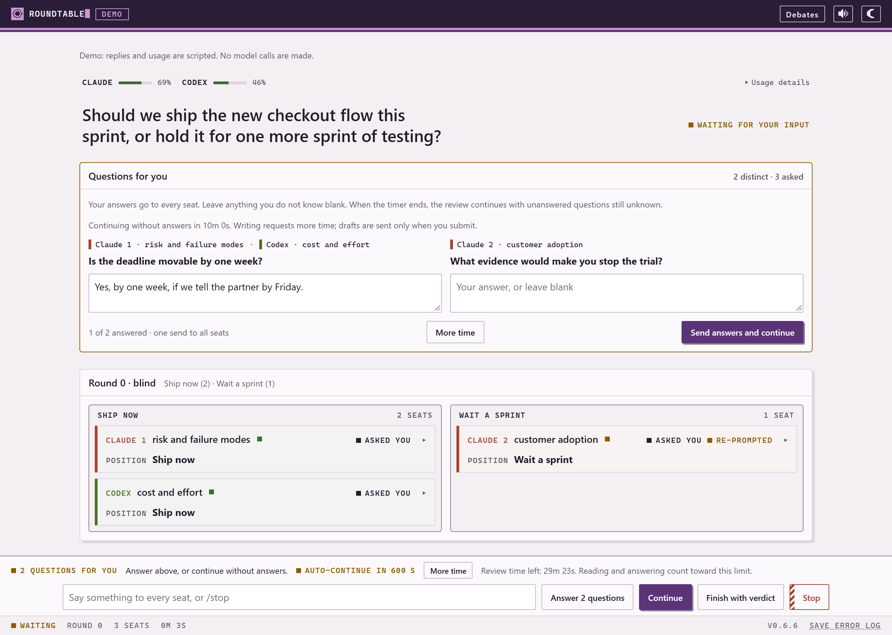

# Roundtable

[](https://www.npmjs.com/package/@prplkane/roundtable)
[](https://github.com/prplkane/roundtable/actions/workflows/test.yml)
[](package.json)
[](LICENSE)

Review a decision with a panel of AI agents and export the outcome as Markdown.

Give the panel a question, alternatives, and constraints. Each reviewer (a **seat**) takes
a position and can critique the others. A final reviewer (the **chairman**) recommends an
option and records the disagreements. You can answer questions along the way and record
your own decision alongside the recommendation.

## Review in the browser

This developer preview runs locally on Node.js 22 or newer. Try the scripted demo to
explore a complete review without a provider account.

```sh
npx @prplkane/roundtable fake
```

Open the [demo board](http://localhost:4748/) and try a question such as **Should a team
release a feature this week or wait one sprint?** Give one seat the cost perspective and
another the rollout risk. Choose **Open the table** to start, then answer questions and
export the decision record.



## Run a live review

The default connection uses **AgentLink**, a local launcher that saves how to start each
agent and which model to use. For a review with two providers, sign in to the Codex and
Claude command-line tools, then create a named profile for each. [About AgentLink](https://github.com/prplkane/agentlink)

```sh
npm install -g @prplkane/roundtable @prplkane/agentlink@beta
agentlink add risk-review --provider codex
agentlink add cost-review --provider claude
roundtable
```

On the [live board](http://localhost:4747/), assign a profile to each seat and the
chairman. One profile can fill several seats. Leave **Model** and **Effort** blank to
inherit its defaults, or choose **Load profile models** for the available choices.
Use **Refresh profile models** after a provider update.

To use a signed-in command-line tool directly, choose the provider entry marked
**direct CLI**. OpenAI-compatible API endpoints are also supported.
[Provider setup and first live review](docs/workflow.md#a-first-live-test-drive)

## Review in Codex with AgentLink seats

To use the same panel from Codex, connect it to Roundtable's review tools through the
Model Context Protocol (MCP). The two profiles above work in both the browser and the assistant.

```sh
roundtable setup --client codex
```

After restarting Codex or reloading its MCP connections, try this request.

> Use Roundtable to decide whether to run a small rollout trial or wait one sprint.
> Give risk to `risk-review` and cost to `cost-review`, with `risk-review` as chairman.
> Run one critique round and bring me the reviewers' questions.


## Records, costs, and privacy

Roundtable keeps review history and usage records on your machine. Live calls send the
decision and relevant discussion to the selected providers under their billing terms.
Round, time, and token limits help control usage. A call already in progress can exceed
a budget estimate. [Limits](docs/workflow.md#set-the-limits) · [Storage and backups](docs/workflow.md#back-up-and-restore)

AgentLink seats use the Agent Client Protocol (ACP) and run with the profile's local
permissions. Use trusted profiles with agent-side tools disabled for reviews.
[Profile setup and permissions](docs/workflow.md#7c-agentlink-acp-profiles)

Direct Antigravity seats require a separate acknowledgment. Google warns that using a
consumer Antigravity account through third-party apps can result in suspension.
[Account notice](docs/workflow.md#antigravity-google) · [Google's Antigravity FAQ](https://antigravity.google/docs/faq)

## Commands and documentation

| Command | Purpose |
| --- | --- |
| `roundtable doctor` | Check local provider setup without sending a model prompt. |
| `roundtable agent --help` | Review from a script using the JSON commands. |
| `roundtable server status` | Check the background board. |
| `roundtable export <review> <folder>` | Export a saved decision into a project directory. |

[User guide](docs/workflow.md) · [Security](SECURITY.md) · [Changelog](CHANGELOG.md) ·
[Report an issue](https://github.com/prplkane/roundtable/issues) ·
[Contributing](https://github.com/prplkane/roundtable/blob/main/CONTRIBUTING.md) · [MIT license](LICENSE)
